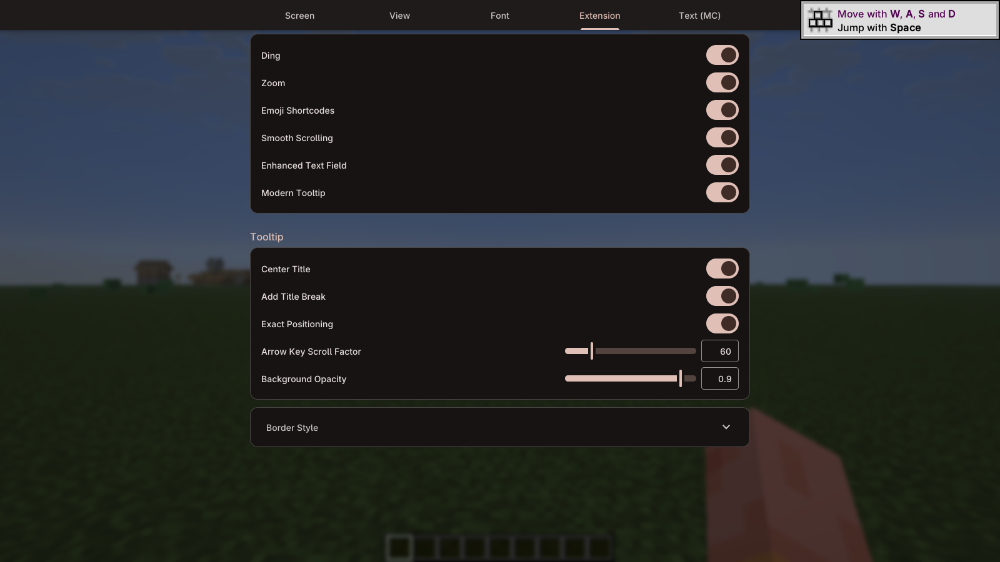
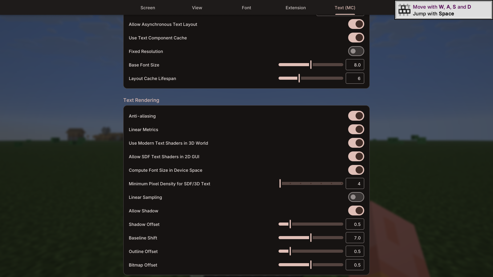

# ModernUI Lumen

ModernUI Lumen brings the ModernUI framework and its text engine to Minecraft: custom fonts, smoother text, and configurable interface effects. It is a fork of [Modern UI for Minecraft](https://www.curseforge.com/minecraft/mc-mods/modern-ui), created by **BloCamLimb** and independently maintained here by **MOPELotus**.

## What it offers

- Choose TrueType/OpenType fonts and edit the **Fallback Font Family List** and **Font Registration List**.
- Use **Modern Text Engine**, **Anti-aliasing**, **Color Emoji**, and **Emoji Shortcodes**.
- Adjust **Blur Effect**, **Background Fade-in Duration**, and tooltip **Border Style**, **Rounded Corners**, and **Adaptive Colors**.
- Enable **Smooth Scrolling** and **Inventory Pause**, or play local music. Other mods can also use the ModernUI interface APIs.

Lumen maintains the Minecraft versions listed below, with fixes for fractional-pixel scrolling text and glyph sampling, including scrolling lyrics. Tooltip layouts, input handling, and rendering integrations are adapted to each version. Configuration is built in on every maintained branch; **Forge Config API Port is not required**.

## Installation

Choose the **standard-edition** JAR for your Minecraft version and **Fabric or NeoForge**, then put it in the client `mods` folder. CurseForge files are standard edition only. Fabric also needs **Fabric API** for your Minecraft version. ModernUI Core is bundled.

| Minecraft | Loader | Java |
| --- | --- | --- |
| 1.21–1.21.1 | Fabric / NeoForge | 21+ |
| 1.21.6–1.21.8 | Fabric / NeoForge | 21+ |
| 1.21.9 | Fabric / NeoForge | 21+ |
| 1.21.10 | Fabric / NeoForge | 21+ |
| 1.21.11 | Fabric / NeoForge | 21+ |
| 26.1–26.1.2 | Fabric / NeoForge | 25+ |
| 26.2 | Fabric / NeoForge | 25+ |
| 26.3 | Fabric / NeoForge | 25+ |

Lumen keeps the `modernui` mod ID and existing API and configuration paths. **Install only one Modern UI edition**: replace the upstream JAR or another Lumen edition rather than keeping both.

Both loaders support OpenGL. Minecraft 26.2/26.3 also have a native Vulkan backend, selected with the **game argument** `--graphicsBackend VULKAN`; `--graphicsBackend OPENGL` selects OpenGL. These are game arguments, not JVM arguments. Earlier versions need a compatible VulkanMod release for their exact Minecraft version and loader if you want to use Vulkan.

Some NeoForge configurations need the early loading window disabled. See the [installation and compatibility notes](https://github.com/MOPELotus/ModernUI-MC-Lumen#readme) for the affected versions and other known mod interactions.

## Credits

Original mod and framework: **BloCamLimb and contributors** — [Modern UI for Minecraft](https://github.com/BloCamLimb/ModernUI-MC) · [ModernUI Framework](https://github.com/BloCamLimb/ModernUI).

Fork maintenance: **MOPELotus** — [source](https://github.com/MOPELotus/ModernUI-MC-Lumen) · [issues](https://github.com/MOPELotus/ModernUI-MC-Lumen/issues). This is an independent fork, not an official upstream release. Licensed under [LGPL-3.0-or-later](https://github.com/MOPELotus/ModernUI-MC-Lumen/blob/master/LICENSE); included fonts retain their own licenses and credits.

---

# 中文介绍

ModernUI Lumen 将 ModernUI 界面框架和文字引擎带到 Minecraft，提供自定义字体、更平滑的文字显示及可配置的界面效果。它是 [Modern UI for Minecraft](https://www.curseforge.com/minecraft/mc-mods/modern-ui) 的 Fork，原作者为 **BloCamLimb**，由 **MOPELotus** 独立维护。

## 功能与改动

- 选择 TrueType / OpenType 字体，编辑「回退字体家族列表」和「字体注册列表」。
- 使用「现代文本引擎」「抗锯齿」「彩色表情符号」和「表情符号简码」。
- 调整「模糊效果」「背景淡入时长」，以及物品提示的「边框样式」「圆角化」和「动态颜色」。
- 开启「平滑滚动」「物品栏暂停」，或播放本地音乐。其他模组也可以用 ModernUI API 来做界面。

Lumen 继续维护上表所列版本，修复了滚动歌词文字抖动，以及不同版本的 tooltip、输入和渲染问题。**所有维护分支均内置配置实现，无需 Forge Config API Port。**

## 安装

把对应 Minecraft 和 Fabric／NeoForge 的**普通版** JAR 放入客户端 `mods`。CurseForge 仅提供普通版。Fabric 还需安装对应 Minecraft 的 **Fabric API**；ModernUI Core 已随包提供。1.21 系列需要 Java 21+，26.x 需要 Java 25+。

Lumen 保留 `modernui` 模组 ID、API 和配置路径。**每次只安装一个 Modern UI 版本**；从原版或另一字体版切换时，替换原有 JAR。

两个加载器均支持 OpenGL。26.2/26.3 可用游戏自带的 Vulkan 后端，在启动器的**游戏参数**中添加 `--graphicsBackend VULKAN`；`--graphicsBackend OPENGL` 切回 OpenGL，不要放入 JVM 参数。较早版本使用 Vulkan 时，需要对应 Minecraft 和加载器的兼容 VulkanMod 包。

部分 NeoForge 配置需要关闭早期加载窗口，适用版本及其他模组兼容说明见[仓库安装说明](https://github.com/MOPELotus/ModernUI-MC-Lumen#readme)。

原项目和框架由 **BloCamLimb 及贡献者**开发，Fork 由 **MOPELotus** 维护，并非上游官方发行版。采用 [LGPL-3.0-or-later](https://github.com/MOPELotus/ModernUI-MC-Lumen/blob/master/LICENSE)，随附字体保留各自许可与署名。[源码](https://github.com/MOPELotus/ModernUI-MC-Lumen) · [问题反馈](https://github.com/MOPELotus/ModernUI-MC-Lumen/issues)。
